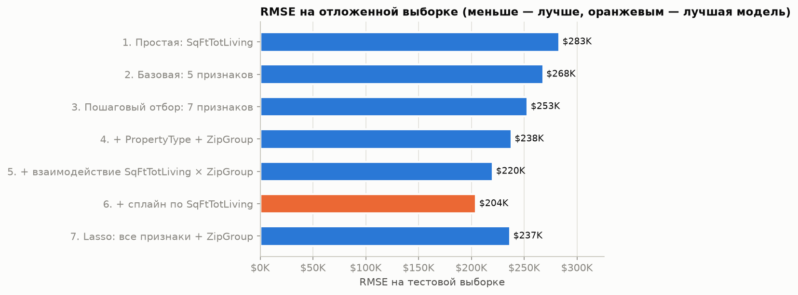
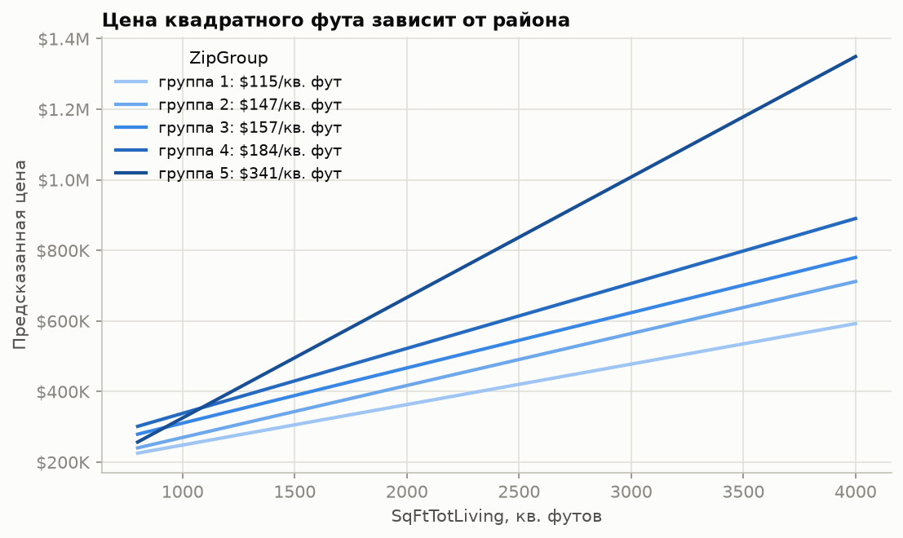
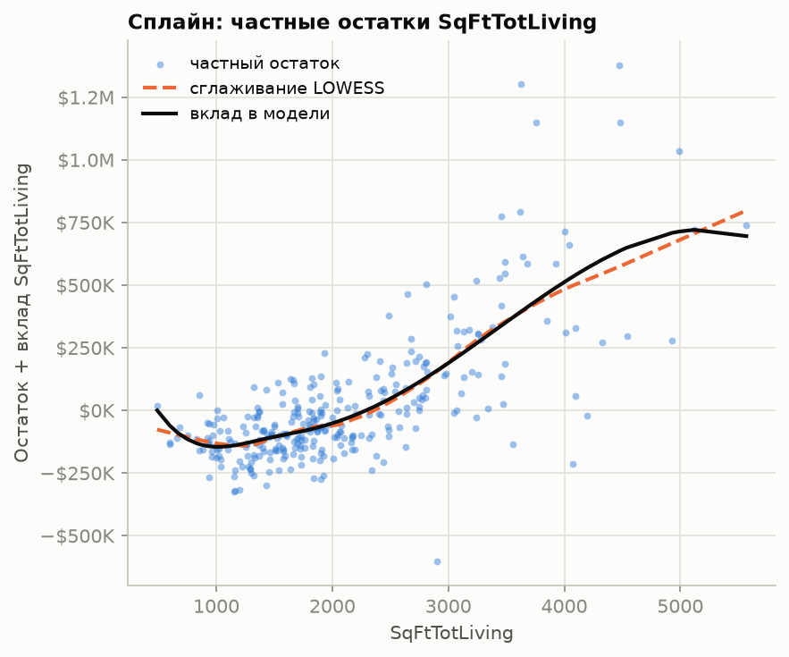

# Оценка стоимости домов: линейная регрессия

Учебный проект по регрессионному анализу: модели оценивают цену продажи дома по его
характеристикам на данных о 22 687 сделках в округе Кинг (Сиэтл, штат Вашингтон) за
2006–2015 годы. Проект включает интерпретацию коэффициентов, отбор признаков, работу
с категориальными признаками, диагностику регрессии, нелинейные модели (сплайны, GAM),
регуляризацию и сравнение моделей на отложенной выборке.

> **Главный результат.** Лучшая модель — линейная регрессия со сплайном по жилой площади
> и его взаимодействием с группой почтовых индексов: на отложенной выборке **RMSE $204K,
> R² = 0.735** против RMSE $268K и R² = 0.545 у базовой модели из пяти признаков.



## Задача

Оценить цену продажи дома по его характеристикам и определить, какие характеристики
и насколько влияют на стоимость.

## Данные

`data/raw/house_sales.csv` — 22 687 продаж, 22 столбца. Целевая переменная
`AdjSalePrice` — цена продажи, приведённая к уровню рынка мая 2015 года индексом цен
на жильё Zillow (`SalePrice / zhvi_idx`), поэтому сделки разных лет сопоставимы.

| Признак | Описание |
|---|---|
| `SqFtTotLiving` | жилая площадь, кв. футов |
| `SqFtLot` | площадь участка, кв. футов |
| `Bathrooms`, `Bedrooms` | число ванных комнат и спален |
| `BldgGrade` | класс качества постройки (1–13) |
| `PropertyType` | дом на одну семью, таунхаус, многоквартирный дом |
| `SqFtFinBasement`, `NbrLivingUnits` | отделанная площадь подвала, число жилых единиц |
| `YrBuilt`, `YrRenovated`, `NewConstruction` | год постройки, год реновации, новостройка |
| `ZipCode` | почтовый индекс (80 значений) |

## Результаты

### 1. Сравнение моделей на отложенной выборке (25%)

| Модель | RMSE (test) | MAE (test) | R² (test) |
|---|---|---|---|
| 1. Простая: жилая площадь | $283K | $163K | 0.492 |
| 2. Базовая: 5 признаков | $268K | $150K | 0.545 |
| 3. Пошаговый отбор по AIC: 7 признаков | $253K | $138K | 0.594 |
| 4. + тип недвижимости + группа индексов | $238K | $123K | 0.641 |
| 5. + взаимодействие площади и группы индексов | $220K | $112K | 0.693 |
| **6. + сплайн по площади** | **$204K** | **$104K** | **0.735** |
| 7. Lasso: все признаки + группа индексов | $237K | $122K | 0.645 |

Основной прирост дают местоположение и его взаимодействие с площадью. RMSE на тестовой
выборке выше обучающей лишь на $6–9K — признаков переобучения нет. Группы почтовых
индексов построены только по обучающей части.

### 2. Что определяет цену

- **Жилая площадь** — главный признак: +$229 за квадратный фут в базовой модели.
- **Местоположение.** 80 почтовых индексов объединены в 5 групп по медианному остатку
  базовой модели. Цена квадратного фута — от $115 в самой дешёвой группе до $341 в самой
  дорогой.
- **Класс постройки:** +$106K за каждую ступень `BldgGrade`.
- **Спальни** при той же площади снижают цену: −$42K за спальню с учётом района, потому что
  больше спален при той же площади — меньше комнаты.



### 3. Интерпретация коэффициентов

- **Коррелированные признаки.** Без площади и ванных коэффициент при спальнях меняет знак
  с −$52K на +$27K: число спален начинает выполнять роль размера дома.
- **Смешивающий фактор.** Без учёта местоположения площадь участка, число ванных и тип
  недвижимости получают противоположный знак. После добавления группы индексов дома на одну
  семью становятся дороже многоквартирных (−$85K → +$19K).
- **Взвешенная регрессия** с большим весом свежих продаж немного сдвигает коэффициенты,
  но не снижает ошибку.

### 4. Диагностика (почтовый индекс 98105, 313 продаж)

- Самый крупный выброс — продажа дома площадью 2900 кв. футов за $120K, на $758K ниже
  предсказания; вероятно, сделка не рыночная.
- Удаление 6 влиятельных наблюдений (расстояние Кука > 0.08) меняет коэффициент при ванных
  с +$2K на −$16K.
- Остатки гетероскедастичны: их разброс растёт с предсказанной ценой.
- По графику частных остатков связь площади с ценой нелинейна.



| Модель (индекс 98105) | R² | AIC |
|---|---|---|
| Линейная | 0.795 | 8464 |
| Квадратичный член по площади | 0.806 | 8450 |
| B-сплайн по площади | 0.814 | 8445 |
| GAM (pyGAM) | 0.812 | 8443 |

## Ход анализа

Ноутбук [`notebooks/house_prices.ipynb`](notebooks/house_prices.ipynb):

1. Данные и распределение цен.
2. Простая линейная регрессия.
3. Множественная регрессия: коэффициенты, RMSE, R², стандартные ошибки и p-значения.
4. Полная модель и пошаговый отбор признаков по AIC.
5. Взвешенная регрессия.
6. Категориальные признаки: фиктивные переменные, группировка почтовых индексов.
7. Интерпретация: коррелированные признаки, смешивающий фактор, взаимодействия.
8. Диагностика: выбросы, влиятельные наблюдения, гетероскедастичность, частные остатки.
9. Нелинейность: полином, B-сплайны, GAM (statsmodels и pyGAM).
10. Регуляризация Lasso с подбором штрафа кросс-валидацией.
11. Сравнение семи моделей на отложенной выборке.
12. Итоги.

## Ограничения

- Модели разделов 3–10 оценены на обучающих данных; на отложенной выборке проверены модели
  раздела 11.
- Распределение цен скошено вправо, и ошибка в долларах определяется дорогими домами.
- Налоговая оценка земли и построек (`LandVal`, `ImpsVal`) не использовалась: это оценка
  той же недвижимости, а не её характеристика.

## Структура

```
House_prices/
├── README.md
├── requirements.txt
├── data/raw/house_sales.csv
├── notebooks/
│   ├── house_prices.ipynb       # анализ с результатами
│   └── _house_prices.py         # исходник ноутбука
├── src/py2nb.py                 # сборка .ipynb из .py
└── reports/figures/             # графики
```

## Стек

Python: pandas, NumPy, matplotlib, scikit-learn (LinearRegression, Lasso, LassoCV, метрики),
statsmodels (OLS, формулы, диагностика влияния, сплайны, GLMGam), pyGAM (LinearGAM).
